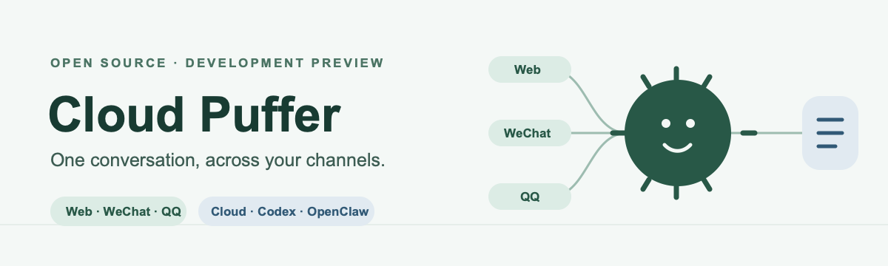
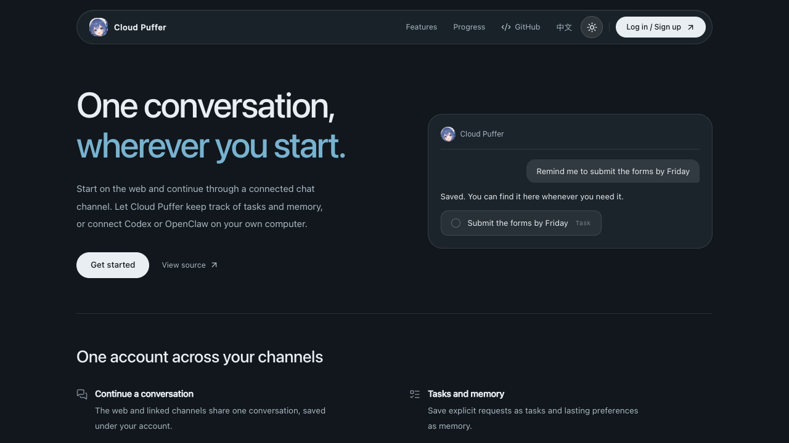

# Cloud Puffer

One account, one conversation across the web and messaging channels. Cloud Puffer keeps identity, tasks, memories, and run state in the cloud. Users can choose the built-in AI assistant or connect Codex / OpenClaw on their own computer.

[](https://github.com/Jobo16/Cloud-Puffer/actions/workflows/ci.yml)
[](LICENSE)

[Try it online](https://puffer.jobo.ink/en) · [Run locally](#run-locally) · [User guide](docs/workspace.md) · [Contribute](CONTRIBUTING.md) · [简体中文](README.md)



## Preview

[](https://puffer.jobo.ink/en)

This is the public homepage; sign in to open the workspace. Click the image to try the hosted preview.

## Current status

| Capability | Status |
| --- | --- |
| Web app, accounts, and main conversation | Live; email sign-up, verification, sign-in, streaming replies, and history |
| Cloud model connections | Code supports Agnes, OpenAI, Anthropic, Google, DeepSeek, Alibaba Cloud Model Studio, and OpenAI-compatible services; the hosted site defaults to Agnes 2.5 Flash, while other providers need keys and live checks |
| Tasks, long-term memory, and assistant settings | Live; account-scoped rules shared by the web and cloud agent |
| WeChat iLink | Enabled in production; QR binding and basic text exchange were verified before the server move and need a new phone check |
| QQ and Telegram private chat | Adapters and automated checks exist; disabled on the hosted site and not verified with real clients |
| Local Codex / OpenClaw | Device connection and text-reply code exist; the local Codex path has produced a real reply, while production end-to-end use remains unverified |

Reminders, file uploads, retrieval, document generation, and a platform-wide spending cap are not implemented. A task deadline does not send a notification. See the [documentation index](docs/README.md) for architecture and limits.

## Run locally

Requires Node.js 24, pnpm 10.30.3, and Docker Compose.

```sh
pnpm install --frozen-lockfile
pnpm dev:setup
pnpm infra
pnpm db:migrate
pnpm dev
```

Run `pnpm worker` in another terminal, then open <http://127.0.0.1:3030>. Local verification emails appear in Mailpit at <http://localhost:18025>. `dev:setup` creates `.env` only when it is absent. The default setup has no model or chat-channel connection. To enable a model, set `MODEL_PROVIDER`, `MODEL_API_KEY`, and `MODEL_NAME`; OpenAI-compatible endpoints also need `MODEL_BASE_URL`. Restart Web and Worker to apply changes. See the [development guide](docs/development.md) for configuration.

## Development and releases

```sh
pnpm typecheck
pnpm lint
pnpm test
pnpm build
```

Tests use a separate `jojobot_test` database and model/channel fixtures. Pull requests run these checks; a passing push to `main` deploys to password-protected staging. Production is released manually through GitHub Actions from the image already tested in staging. See the [deployment guide](docs/deployment.md).

Read [CONTRIBUTING.md](CONTRIBUTING.md) before contributing and [SECURITY.md](SECURITY.md) for vulnerability reports. Original project work is [MIT licensed](LICENSE); see [NOTICE](NOTICE) and [third-party notices](THIRD_PARTY_NOTICES.md) for attribution.
