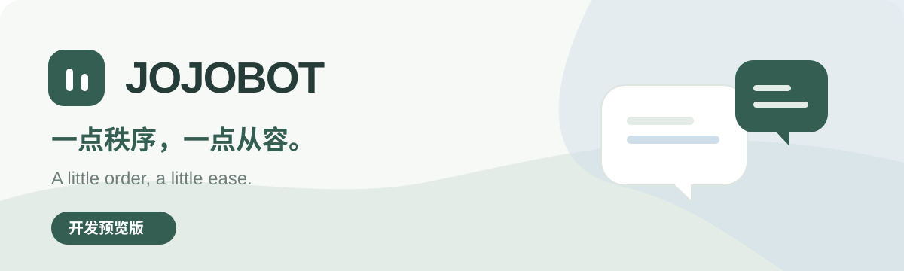

# JOJOBOT

**A personal AI assistant for everyday life, across web and chat.**

[简体中文](README.md) · [What works](#project-status) · [Run locally](#run-locally) · [Architecture](docs/architecture.md) · [Roadmap](docs/PRD.md)

JOJOBOT keeps one conversation, tasks, and personal memory together for each account. It runs as one shared service, without a separate machine for every user.

## Project status

> **Development preview.** You can run the application locally. The hosted service is not public, and the WeChat and QQ adapters still need real-account verification. Model, private file storage, and production email providers have not been selected.

Available in this preview:

- A public project homepage with modal sign-in, registration, and password recovery.
- Open email/password registration, email verification, password changes, and session revocation.
- An Apple-inspired glass workspace: configuration on the left and a persistent phone chat preview on desktop; direct conversation on mobile.
- Saved assistant name, persona, custom instructions, and task/memory/sticker switches, applied to the next reply across channels using real account data.
- Persistent tasks and explicit personal memory, editable from the web or through agent tools.
- One conversation per account, queued model execution, incremental responses, cancellation, tool result records, history pagination, and daily message limits.
- An iLink text adapter: QR binding, encrypted credentials, shared polling, durable deduplication, and conservative submission status. **Real WeChat account/device verification remains pending.**
- A shared official QQ bot adapter for private text chat: one-time account binding, shared conversation/queue, and bounded text/image replies. QQ credentials, permissions, and real-device verification remain pending.
- Natural-language reply guidance and four original built-in stickers for web/QQ, with a per-account opt-out and no consecutive reuse of the same sticker. Reading incoming images and learning a user's writing style are not implemented.

Still planned: scheduled reminders and calendar events, search, notes, private files, document generation/retrieval, operational administration, and platform-wide cost limits. A task deadline does **not** currently send a reminder.

## Run locally

Requires Node.js 24, pnpm 10.30.3, and Docker Compose.

```sh
pnpm install --frozen-lockfile
pnpm run dev:setup
pnpm infra
pnpm db:migrate
pnpm dev
```

In another terminal:

```sh
pnpm worker
```

Open [localhost:3030](http://localhost:3030). Verification/reset messages go to the local [Mailpit inbox](http://localhost:18025); they are not sent to the internet. Registration does not require an invitation code. `dev:setup` preserves an existing `.env` and generates private secrets only when the file is absent.

The default configuration has **no model connection**. Tasks and memory work without one; chatting reports that the model is unavailable. Configure `MODEL_BASE_URL`, `MODEL_API_KEY`, and `MODEL_NAME` in `.env` for an OpenAI-compatible chat-completions provider that supports streaming and tool calls, then restart Web and Worker. Provider compatibility still needs verification with the chosen supplier.

WeChat is disabled by default. Set `ILINK_ENABLED=true` to begin integration testing with a separate test WeChat account. Do not connect the same account to two deployments. An accepted API submission is not proof of delivery or reading; uncertain sends are not automatically retried.

QQ is also disabled by default. After deployment preparation, set `QQ_ENABLED`, `QQ_APP_ID`, and `QQ_APP_SECRET` for a platform-owned QQ bot; `QQ_BOT_URL` optionally links to its sharing page. Users bind from Settings by privately sending the one-time command to that bot. See [QQ and DSH plugin research](docs/research/qq-and-dsh-plugins-2026-11-02.md) and [deployment requirements](docs/deployment.md). No DSH plugin runtime is installed.

## Development

```sh
pnpm typecheck
pnpm lint
pnpm test
pnpm build
```

Tests create and migrate a separate `jojobot_test` database on the local development PostgreSQL server. They use model/network fixtures and local Mailpit, never production credentials. See [development and verification](docs/development.md) for details, configuration, and current limitations.

The stack is Next.js 16, React 19, TypeScript, Tailwind CSS 4, Base UI, AI SDK, Better Auth, Drizzle, PostgreSQL 17, and pg-boss. A single shared worker serves accounts concurrently while ordering each user's turns. No per-user VM/container, Redis, or additional agent framework is required.

Stop the development server before changing dependencies, then restart it. Installing packages while Turbopack is watching can cause repeated reloads while pnpm reorganizes dependencies.

## Self-hosting and contributing

[Docker deployment](docs/deployment.md) describes a shared Web/Worker/PostgreSQL installation. End users of a future hosted service will not configure providers; self-hosting operators must configure them. File/object storage is not implemented yet.

Start with the [PRD](docs/PRD.md), [architecture](docs/architecture.md), and [contribution conventions](AGENTS.md). Small, complete changes and reproducible bug reports are welcome. The full [documentation index](docs/README.md) includes the original technology and open-source research.

## License

[MIT](LICENSE). Copyright © 2026 JOBO. See [third-party notices](THIRD_PARTY_NOTICES.md) for the adapted glass material and dependency licenses.
