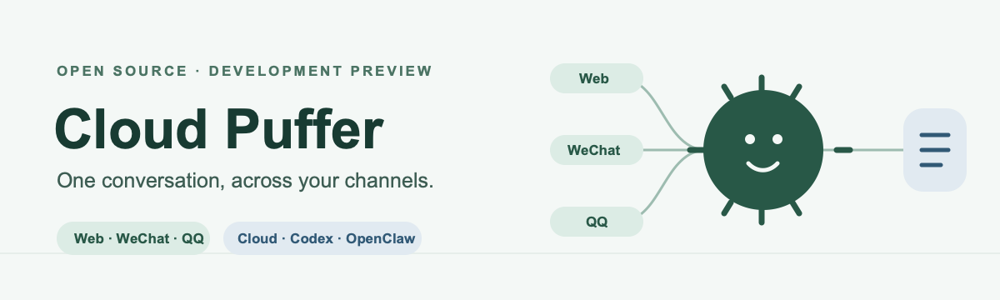
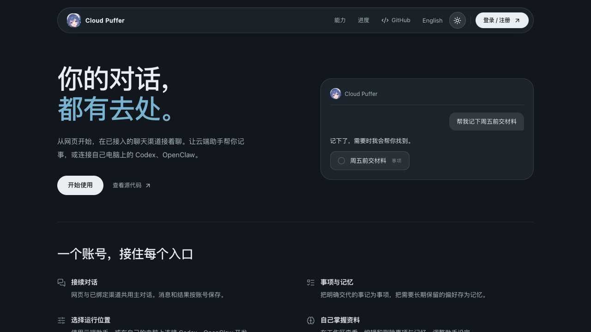

# Cloud Puffer

一个账号，一条跨网页和聊天渠道的主对话。Cloud Puffer 将身份、事项、记忆和任务状态保存在云端；用户可选择内置 AI 助手，或连接自己电脑上的 Codex / OpenClaw。

[](https://github.com/Jobo16/Cloud-Puffer/actions/workflows/ci.yml)
[](LICENSE)

[在线体验](https://puffer.jobo.ink) · [本地运行](#本地运行) · [使用文档](docs/workspace.md) · [参与贡献](CONTRIBUTING.md) · [English](README.en.md)



## 产品预览

[](https://puffer.jobo.ink)

这是公开首页；登录后可进入工作区。点击图片可在线体验。

## 当前能力

| 功能 | 状态 |
| --- | --- |
| 网页、账号与主对话 | 已上线；支持邮箱注册、验证、登录、流式回复与历史记录 |
| 云端模型接入 | 代码支持 OpenAI、Anthropic、Google 原生 API 及兼容 OpenAI 的服务；自动化测试已通过，具体供应商需配置密钥并实测 |
| 事项、长期记忆与助手设定 | 已上线；按账号隔离，网页与云端 Agent 共用业务规则 |
| 微信 iLink | 生产已开启；迁移前验证过扫码与基础文字收发，迁移后仍需手机实测 |
| QQ、Telegram 私聊 | 适配器和自动化检查已实现；托管站关闭，尚未完成真实平台验收 |
| 本地 Codex / OpenClaw | 设备连接与文字回复代码已实现；Codex 本地链路曾完成实际回复，生产端到端仍待验收 |

目前没有定时提醒、文件上传、资料检索、文档生成或全平台成本硬上限。待办的截止时间不会触发通知。当前架构和能力边界见[文档索引](docs/README.md)。

## 本地运行

需要 Node.js 24、pnpm 10.30.3 和 Docker Compose。

```sh
pnpm install --frozen-lockfile
pnpm dev:setup
pnpm infra
pnpm db:migrate
pnpm dev
```

另开终端运行 `pnpm worker`，然后访问 <http://localhost:3030>。本地验证邮件进入 <http://localhost:18025> 的 Mailpit。`.env` 由 `dev:setup` 首次生成，不会覆盖已有配置；默认不连接模型或聊天渠道。要使用模型，设置 `MODEL_PROVIDER`、`MODEL_API_KEY`、`MODEL_NAME`；兼容 OpenAI 的端点还需 `MODEL_BASE_URL`。重启 Web 与 Worker 后生效。完整配置见[开发说明](docs/development.md)。

## 开发与发布

```sh
pnpm typecheck
pnpm lint
pnpm test
pnpm build
```

测试只使用独立的 `jojobot_test` 数据库和模型、渠道替身。PR 执行上述检查；`main` 检查通过后自动发布到受密码保护的 staging；生产发布由 GitHub Actions 手动触发，并复用 staging 验证过的镜像。详见[部署说明](docs/deployment.md)。

贡献前请阅读[参与指南](CONTRIBUTING.md)，漏洞报告见[安全政策](SECURITY.md)。原创内容采用 [MIT](LICENSE)；第三方素材与依赖声明见 [NOTICE](NOTICE) 和[第三方声明](THIRD_PARTY_NOTICES.md)。
