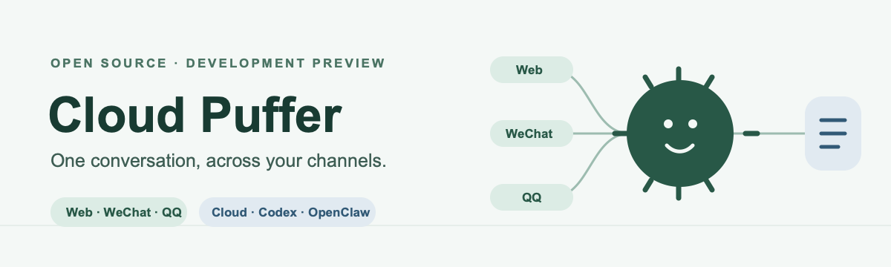
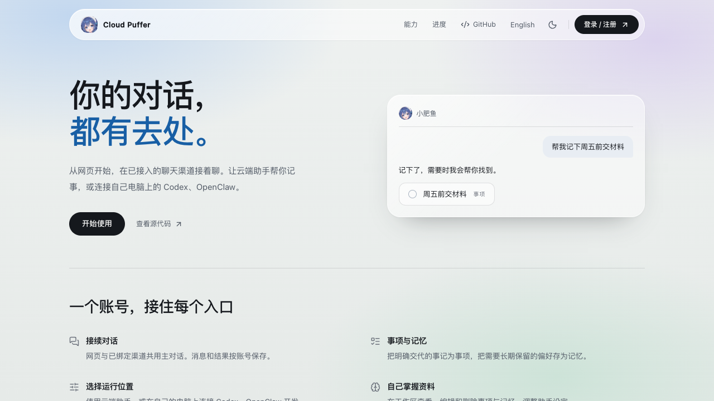
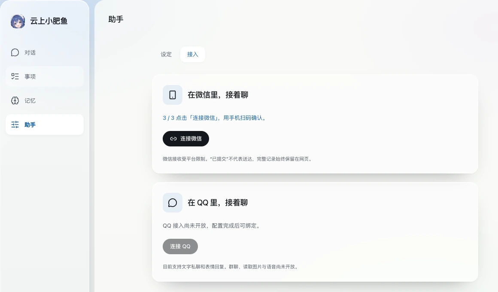

# Cloud Puffer

### 多种入口，同一段对话。

**[打开网页版 →](https://fish.jobo.ink)** · [使用教程](docs/workspace.md) · [English](README.en.md) · [当前状态](#当前状态) · [本地运行](#本地运行) · [实现架构](docs/architecture.md) · [产品规划](docs/PRD.md)

Cloud Puffer 的目标是连接各种收发渠道与 Agent 运行方式，让同一账号始终接续一条主对话。当前已有网页和微信入口、QQ 与 Telegram 适配代码；WhatsApp、飞书等渠道将逐步接入。云端负责身份、待办、记忆、运行顺序与回复状态，并提供内置 Agent；开发预览版还提供用户电脑上的 Codex/OpenClaw 文字连接。已实现与规划的边界见[当前状态](#当前状态)和[接入方向](docs/channel-agent-gateway.md)。

**适合谁？** 想在不同聊天入口接续同一个 Agent 的个人用户，以及想自行部署、扩展渠道或接入本地 Agent 的开发者。



图示表达渠道与 Agent 的连接方向；实际可用范围见下文。

## 页面预览

[](https://fish.jobo.ink)

首页 · 点击图片打开网页版



助手 › 接入 · 本地测试账号截图

## 当前状态

> **开发预览版。** 托管站点已部署到 [fish.jobo.ink](https://fish.jobo.ink)，Web、Worker、数据库及两轮真实百炼模型回复已验收，第二轮报告命中 3,072 个缓存输入 token。线上微信已完成扫码和基础文字收发；QQ 实机收发与微信长期稳定性仍待验收。私有文件存储尚未选定；QQ 邮箱 SMTP 已发出管理员验证邮件并完成邮箱验证。

当前预览版已有：

- 中英文公开首页与工作区语言切换；首页分别位于 `/`、`/en`，提供独立标题、描述、规范地址、语言互链、站点地图与抓取规则。登录、注册和找回密码使用浮窗。
- 邮箱密码开放注册、邮箱验证、修改密码和登录会话撤销。
- 参考 Apple 的玻璃风格工作区：桌面左侧为功能导航，右侧为当前页面；手机端使用同一条主对话。
- 可保存助手名字、系统提示词及待办/记忆/表情开关，下一轮回复生效；各渠道共用配置和真实资料。
- 持久化的待办和明确保存的个人记忆；记忆按需查询、去重、可修改和忘记，网页与 Agent 共用业务规则。见[自然回复与记忆设计](docs/memory-and-replies.md)。
- 每账号一条主对话、后台执行、逐步显示回复、停止执行、操作记录、历史翻页和按 token 结算的每日积分。
- 模型历史按长度控制，复用稳定的对话前缀，并记录供应商报告的缓存命中 token。
- 已验证的管理员账号可从「助手 › 设定」进入简易后台，搜索账号、查看今日积分并调整个人每日额度。
- iLink 文本适配：扫码绑定、凭据加密、共享轮询、持久化去重与投递状态。首次微信回复附带修改备注名和头像的说明、操作示意图与头像图。**本地已验证扫码、文字收发和网页接续；线上已验证扫码与基础文字收发。欢迎图片的手机端送达和长期稳定性仍待验收。**
- QQ 官方机器人私聊适配：一次性账号绑定、共用主对话与队列、限制条数的文字和图片回复。QQ 凭据、权限与真实设备收发仍待验证。
- Telegram 机器人私聊适配：一次性绑定码、共用主对话与队列、文字接收及回复。默认关闭，尚无真实 Bot 凭据与实机验证。
- 本地开发代码可将新对话交给用户电脑上的 Codex 或 OpenClaw：网页生成可撤销的设备令牌，本地连接程序确认后处理文字并返回主对话。该增量尚未部署线上；本机 Codex 已经由网页 API 经 HTTP 完成真实回复，OpenClaw、浏览器操作与真实渠道回传仍待验收；本地 Agent 不具备网页事项/记忆工具。见[接入边界](docs/channel-agent-gateway.md)。
- 自然语气约定与四张原创内置表情，用于网页和 QQ，可按账号关闭，避免相邻轮次重复同一张。尚不支持理解用户发来的图片或自动学习说话风格。

后续开发：WhatsApp、飞书等渠道及 Telegram 媒体，定时提醒、起止时间日程、搜索、笔记、私有文件、资料检索与文档生成、完整运营管理及全平台成本上限。现在的待办截止时间**不会触发提醒**。

## 使用工作区

登录后进入对话页。桌面左侧是四个入口：对话、事项、记忆、助手；手机端在左上角按钮里打开同一个菜单。名字、系统提示词和能力开关在「助手 › 设定」里，修改后自动保存，下一轮回复生效；微信、QQ 和 Telegram 绑定收在「助手 › 接入」。账号、今日积分和退出登录在左下角个人菜单，手机在顶栏右侧。默认每日 1000 积分；输入每 1,000 token 计 1 分，输出每 1,000 token 计 3 分，分别向上取整。

工具开关不会删除已有待办或记忆，手动管理仍然可用；关闭记忆后不再提供记忆查询与写入工具，但聊天历史仍保留。配置改动会自动落盘；聊天草稿切换页面仍保留，刷新或关闭页面不恢复。完整操作与边界见[工作区使用说明](docs/workspace.md)。

## 本地运行

需要 Node.js 24、pnpm 10.30.3 和 Docker Compose。

```sh
pnpm install --frozen-lockfile
pnpm run dev:setup
pnpm infra
pnpm db:migrate
pnpm dev
```

另开一个终端运行：

```sh
pnpm worker
```

打开 [localhost:3030](http://localhost:3030)。注册无需邀请码，验证与重设密码邮件在本地 [Mailpit 收件箱](http://localhost:18025) 查看，不会发送到互联网。`dev:setup` 仅在 `.env` 不存在时生成私密配置，不覆盖现有文件。

默认**未连接模型**。待办和记忆可以直接使用；聊天会如实提示服务尚未配置。在 `.env` 填入 `MODEL_BASE_URL`、`MODEL_API_KEY`、`MODEL_NAME`，使用支持流式回复及工具调用的 OpenAI 兼容 chat-completions 服务，再重启 Web 和 Worker。本地已验证百炼 `qwen3.8-flash` 的文字回复；完整工具调用仍需验证。

微信默认关闭。设置 `ILINK_ENABLED=true` 后，可使用独立测试微信进行接入验证。不要让同一微信账号同时连接两套部署。“已提交微信”不代表送达或已读；投递不确定时不会自动重复发送。

QQ 也默认关闭。部署准备完成后配置平台机器人的 `QQ_ENABLED`、`QQ_APP_ID`、`QQ_APP_SECRET`；可通过 `QQ_BOT_URL` 提供机器人分享链接。用户在设置生成一次性绑定指令，在 QQ 私聊发给机器人即可绑定。准入和插件分析见 [QQ 与 DSH 插件调研](docs/research/qq-and-dsh-plugins-2026-11-02.md)，外部验收见[部署说明](docs/deployment.md)。未安装 DSH 插件运行环境。

Telegram 默认关闭。自行创建 Bot 后配置 `TELEGRAM_ENABLED=true`、`TELEGRAM_BOT_TOKEN` 和 `TELEGRAM_BOT_USERNAME`，重启 Web 与 Worker；用户在「助手 › 接入」生成一次性指令并发给机器人私聊。当前只收发文字，真实 Bot 网络与客户端尚未验证。

## 开发与检查

```sh
pnpm typecheck
pnpm lint
pnpm test
pnpm build
```

测试在本地开发 PostgreSQL 中创建并迁移独立的 `jojobot_test` 数据库，使用模型/网络测试替身及本地 Mailpit，不读取生产凭据。2026-11-12 已通过 59 项集成检查、类型检查、Lint 和生产构建；本机 Codex CLI 在测试库经网页 API、HTTP 设备桥、真实本地连接程序完成回复并保存。浏览器操作与真实渠道回传尚未实测。生产站点此前已验证健康检查、邮箱注册与管理员登录、两轮真实模型回复及缓存用量。既有基线完成 Docker 与桌面/手机视口验收，单个微信账号完成本地文字收发验证。欢迎图片发送由测试替身验证，手机端送达仍待验收。检查记录与当前限制见[开发与验证](docs/development.md#验证记录)，开源复用选择见[复用记录](docs/research/open-source-reuse-2026-11-12.md)。

技术栈：Next.js 16、React 19、TypeScript、Tailwind CSS 4、Base UI、AI SDK、Better Auth、Drizzle、PostgreSQL 17、pg-boss。一个共享 Worker 并发服务多个用户，同一用户的对话按顺序执行；无需每用户容器、Redis 或额外 Agent 框架。

修改依赖前先停止开发服务，安装完成后重启。生产构建与开发服务分开运行。重复编译的已知触发点与处理方式见[开发排错](docs/development.md#反复编译或页面刷新)。

## 自行部署与参与开发

[Docker 部署说明](docs/deployment.md)提供 Web、Worker、PostgreSQL 共享部署方式及固定发布、备份、镜像和构建缓存清理流程。托管服务的普通用户无需配置供应商；自行部署的维护者需要完成配置。目前尚未接入文件及对象存储。

先阅读[产品需求](docs/PRD.md)、[实现架构](docs/architecture.md)和[工作约定](AGENTS.md)。欢迎提交边界清晰的改进或可复现的问题；原始选型与开源项目调研见[文档索引](docs/README.md)。

## 许可证

项目原创内容采用 [MIT](LICENSE)；版权及第三方许可见 [NOTICE](NOTICE) 和[第三方声明](THIRD_PARTY_NOTICES.md)。
