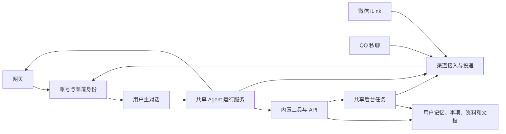

# JOJOBOT 产品需求文档

版本：v0.6 · 日期：2026-11-02 · 状态：需求草案，核心范围已由产品负责人确认，细节建议待审阅。

当前已有账号、配置工作区、主对话、待办/记忆及微信/QQ 适配增量，实际实现与待办见 [开发与验证](development.md)，并非下述首版能力全部完成。

本文定义产品行为与验收标准；技术栈、数据表和部署方案另行设计。文中的“建议”是本次调研提出的默认方案，不代表用户已经确认。尚无上线时间或已达成的性能承诺。

## 1. 产品定位

JOJOBOT 是面向普通个人的云端 AI 助手，帮助用户通过自然对话记录事情、安排提醒、整理信息、查找个人资料和生成文档。用户注册后即可使用，平台提供模型和运行服务。

项目采用 MIT 许可证开源，提供中英文 README。托管服务开放注册，不需要邀请码；普通用户无需配置模型或部署服务。开源代码供开发者阅读、修改与自行部署，自部署需要配置运行环境和服务凭据。

用户在微信说“明天下午三点提醒我交材料”，之后可以在网页查看和修改；在微信上传资料，之后可以在网页继续要求“把刚才那份整理成一页提纲”。助手共享用户的对话、记忆和资料。

产品独立于 IELTS Buddy：采用共享服务承载用户的方向，账号、数据和业务能力独立。

## 2. 已确认的产品决策

以下决策来自 2026-11-02 本次会话中用户的明确选择。

| 编号 | 决策 |
| --- | --- |
| D01 | 目标用户为普通个人，首批场景为日程待办、信息整理、资料和文档助手。 |
| D02 | 平台集中部署，共享服务承载多个用户；不为每个用户或 Agent 分配常驻服务器、容器或完整电脑环境。 |
| D03 | 首版通过预设工具/API 执行任务，不开放任意代码执行、浏览器自动操作和安装依赖。 |
| D04 | 首版对话入口为网页和微信 iLink，架构预留其他渠道。 |
| D05 | 首版先做内置待办、提醒和资料管理，外部应用连接后续接入。 |
| D06 | 开放注册、首版免费试用，不需要邀请码；平台提供模型并设置使用额度。 |
| D07 | 同一个用户的微信与网页共用一条主对话，在网页能查看并继续微信聊天。 |
| D08 | 微信无法投递提醒时，保留网页记录并标明微信未发送；试用版接受该限制，首版不增加邮件提醒兜底。 |
| D09 | 网页采用邮箱和密码注册登录；微信绑定在网页登录后单独完成。 |
| D10 | 项目开源，采用 MIT 许可证；README 提供英文与简体中文两版。 |
| D11 | 网页使用参考 Apple 设计的 Glassmorphism 风格，优先复用现成 UI 组件；替换此前的扁平化视觉要求。 |
| D12 | 首版部署在现有 Linux 云服务器，使用 Docker。 |
| D13 | 提供公开的开源项目介绍首页；登录、注册采用浮窗，不单独设计登录页。 |
| D14 | 工作区按功能分一级入口：对话、事项、记忆、助手。对话是完整主界面，不再用手机框做预览；账号、今日用量和退出收在左下角个人菜单。 |
| D15 | 首步组装功能包含编辑助手名字、人设、自定义提示词和工具开关；配置按账号保存，下一轮回复生效。 |
| D16 | 先实现 QQ 官方机器人私聊、受控表情包与自然回复；主体认证、公开服务权限及真实 QQ 验收在部署阶段处理。 |

## 3. 首版目标与范围

首版要验证：用户是否愿意把日常小事和资料持续交给 JOJOBOT，以及跨微信、网页使用同一个助手是否减少重复解释。

### 3.1 必须完成的闭环（P0）

| 能力 | 首版交付 |
| --- | --- |
| 账号和微信绑定 | 邮箱注册与验证、登录退出、修改/找回密码、绑定/解绑/重新绑定微信、连接状态。 |
| 个人助手 | 每人一个默认助手，可编辑名字、人设、提示词和能力开关；一条持续的主对话，文本聊天，调用内置工具，清楚报告结果和失败。 |
| 待办和日程 | 自然语言创建、查询、修改、完成待办；创建、修改、取消带起止时间的日程。 |
| 提醒 | 一次性和简单重复提醒，到时记录，尝试微信通知，展示真实投递状态。 |
| 信息整理 | 联网搜索、读取可访问网页、带来源的摘要；按用户要求保存笔记或链接。 |
| 个人记忆 | 用户要求记住的偏好或长期事实，可查看、修改、删除。 |
| 资料和文档 | 上传、保存、解析和查询个人资料；生成可查看、下载的文档。 |
| 使用额度和运营 | 每用户额度、全平台成本上限、注册限流、停用账号、故障定位。 |

### 3.2 后续范围（P1）

飞书/Telegram 对话入口、个人邮箱/日历/笔记应用连接、完整语音识别、图片与扫描 PDF 理解、定时搜索和 AI 简报、多条对话、付费订阅。

2026-11-02 补充决策：按 D16 先实现 QQ 私聊和自然表达的最小增量，默认关闭 QQ，部署后完成主体/权限和真实收发验收。表情先用四张原创内置素材，按语境选择，用户可关闭；群聊、主动通知、私人图库与自动风格学习不在本增量内。准入条件和插件分析见 [QQ 与 DSH 插件调研](research/qq-and-dsh-plugins-2026-11-02.md)，实际完成状态见[开发与验证](development.md)。

### 3.3 首版不包含

多 Agent 角色市场、团队共享工作区、插件市场、用户自建工具、用户配置模型密钥、任意 MCP 服务接入、桌面或浏览器控制、自动安装软件、微信群消息管理、读取其他微信联系人聊天记录、替用户向任意联系人发消息。

## 4. 主要用户旅程

### 4.1 从注册到第一次完成任务

1. 用户从项目首页打开注册浮窗，用邮箱和密码注册并验证邮箱；系统创建个人空间和默认助手，无需邀请码或人工审批。
2. 进入工作区：默认落在对话页，手机端同样先看到对话。可先通过网页使用，微信绑定不是前置条件。
3. 用户从设置发起微信绑定，在微信扫码确认；页面显示绑定结果。
4. 用户发出“明天 15 点提醒我交材料”，助手保存提醒，并回复完整日期、时间和事项。
5. 用户打开网页能看到这次对话、事项及提醒状态。

### 4.2 在两端接续处理资料

1. 用户从微信发送一份支持的文件，助手告知接收/解析结果。
2. 用户在网页说“提取刚才那份文件的关键事项”，助手引用同一份资料。
3. 用户要求保存摘要、创建待办或生成文档；各结果持久保存，可从网页再次打开。
4. 用户明确要求“发到微信”时，尝试发送文档或访问链接，并报告实际提交结果。

### 4.3 提醒到时与微信不可达

1. 到时先产生提醒记录，网页主对话和事项详情都可以查看。
2. 已绑定且渠道允许发送时，尝试提交微信消息。
3. 未绑定、登录失效或窗口不可用时，记录“微信未发送”及原因；不把它显示为用户已收到。
4. 用户回来后仍能看到提醒；修复连接后由用户决定是否重发，避免补发一批过时提醒。

### 4.4 配置并试聊（当前已实现）

1. 用户编辑助手名字、人设和提示词，开启或关闭待办、记忆、表情能力。
2. 改动自动保存并归属当前账号；下一轮回复使用已保存的配置。
3. 在对话页发送消息，下一轮运行使用保存的配置。对话会影响真实资料并使用当日额度。
4. 切换配置、事项、记忆或连接设置，聊天草稿仍保留；刷新只恢复已持久化内容。

前述提醒、文件用户旅程是首版目标；当前不能据此宣称具备提醒或文件能力。当前可操作步骤见[工作区说明](workspace.md)。

## 5. 功能与行为要求

### F01 账号、注册与个人空间

- 任何用户均可自行注册，无邀请码或人工审批。邮箱验证后开放助手调用额度；验证和找回密码使用有时效、一次性凭证。
- 同一邮箱不能重复创建账号；注册、登录和验证邮件发送有频率限制，避免公开注册耗尽平台资源。
- 邮箱是账号标识，微信连接是该账号的一个入口。不能通过昵称、邮件地址相似或模型推断合并账号。
- 建议首版每个用户一个助手、一个个人空间、一个有效微信连接。试用用户不需要理解“租户”“模型供应商”等概念。
- 已登录用户可修改密码并退出其他登录；忘记密码时通过已验证邮箱自助重置，不以仅提供一个邮箱地址作为身份凭证。事务邮件用于验证和账号恢复，不作为首版事项提醒的兜底渠道。
- 用户可请求删除账号及个人数据；首版可由管理员执行，需停用连接、取消任务、清理在线数据与资料索引。备份保留周期在试用前明确告知。

### F02 微信连接生命周期

- 绑定由已登录的用户发起，二维码与本次账号、有效期绑定。扫码确认的身份必须与后续消息发送者核对。
- 同一微信身份不能静默转移给另一个 JOJOBOT 账号。重新绑定更新连接，保留本人的历史和业务数据。
- 用户可以查看“未绑定、等待扫码、已连接、连接异常、需要重新绑定”等状态。
- 区分连接登录失效与消息回复窗口失效：后者不必一律要求重新扫码，按实际原因提示用户发一条新消息或重新绑定。
- 解绑后停止该连接的新消息处理和未提交投递；不把旧连接的待发送结果自动转给新绑定。
- 平台不向客户端和普通日志暴露 Bot 凭据。

### F03 一条主对话与渠道回复

- 网页展示微信、QQ 与网页消息的统一时间线，刷新或换设备不丢失；能对最近资料、事项和文档继续指代。
- 常规回复送回发起该轮消息的渠道，网页始终展示完整记录。网页提问不会默认额外推送微信；用户可以明确要求发送到微信。
- 多个渠道同时发来消息时，按服务端接收顺序处理同一用户的对话轮次，避免相互覆盖和重复创建事项；不同用户互不阻塞。
- 长任务显示等待/处理中/完成/失败，用户可以离开页面，结果保留。提交后到达的其他消息不得丢失。
- 微信以完整回复、必要的简短进度和文件/链接表达；网页可流式输出。两端执行权限和业务结果一致。
- 重复回调、刷新和网络重试不得重复产生任务、提醒或文档。重试优先返回已有结果。
- “清空对话”清理历史及其上下文，不连带删除独立保存的待办、记忆和资料；界面说明影响。清理前给出明确确认。

### F04 Agent 执行原则

- 模型根据上下文判断自然回答、追问、搜索、读资料或调用工具。常规业务不依赖关键词把用户强制分流到固定流程。
- 只有在缺少的信息会影响执行结果时追问。例如“提醒我一下”需要补时间和内容；“明天 15 点提醒交材料”可直接保存。
- 用户明确要求的普通创建、修改和单项删除可以执行；目标不明确时先查找并澄清。批量删除、清空数据需确认影响范围。
- “已创建”“已修改”“已生成”必须对应可读取的持久化结果。失败可恢复时尝试修正；无法完成时说明当前结果，不编造成功。
- 文件、网页内容属于待处理材料，其中的文字不能自行授权工具、改变用户身份或读取其他用户数据。

### F05 待办、日程与提醒

- 待办至少有标题、状态，可附截止时间与备注；日程至少有标题、开始时间，可附结束时间与备注。首版用列表查看，无需复杂月历。
- 支持“把刚才那件事改到周五”“这个完成了”“我今天有哪些事”等接续操作，修改前解析到唯一事项。
- 提醒可以附着于待办/日程，也可以独立存在；到期时间和提醒时间明确区分，未指定提醒不擅自创建通知。
- 支持一次性、每天、每周指定星期的重复；不要求用户填写 cron 表达式。取消或修改后，旧计划不得继续触发。
- 建议首版使用北京时间 Asia/Shanghai，保存和回复完整日期。用户指定其他时区时明确换算或澄清，不静默按北京时间执行。
- 固定提醒到时不调用模型，不依赖当天 AI 对话额度；每个周期有独立的触发记录。
- 服务中断期间错过的提醒，恢复后补记为“错过提醒”，不自动集中推送；重复提醒从下一次时间继续。
- 创建超出当前微信可回复窗口的提醒仍可成功，但要简短说明微信通知取决于届时渠道状态，网页一定保留记录。

### F06 搜索、笔记与记忆

- 联网搜索与网页读取用于公开、无需用户登录的内容；回答附可访问来源，区分来源事实与助手推断。读取失败不假装看过全文。
- 用户要求保存时，将文本、链接和摘要保存为个人资料，可按标题或内容检索；普通搜索结果不自动永久收藏。
- 建议首版只保存用户明确要求记住的信息，如“记住我喜欢简短回答”，不默认从所有聊天提取个人画像。
- 记忆可以查看、修改、忘记；忘记后不再作为长期偏好注入。同一事实仍在当前对话中时，应允许用户同时清理相关聊天。
- 待办、提醒和文档是独立业务记录，不能仅存在于模型记忆中。

### F07 资料与文档

- 建议 P0 支持文本型 PDF、DOCX、TXT、Markdown 的接收、保存和解析；扫描 PDF、图片、音视频和其他格式在首版明确提示暂不支持。
- 微信若已有可用的语音转写文本，可作为文本输入并注明转写来源；不承诺首版完整音频识别能力。
- 资料有“接收中、解析中、可用、解析失败”等状态。只读取部分内容时说明范围；不以文件上传成功冒充全文读取成功。
- 资料回答需能定位到文件，能提供页码/章节时一并提供；删除资料后，从后续检索和缓存索引中移除，历史对话引用也不应授予下载权限。
- 建议文档首版支持正文预览、Markdown 和 DOCX 下载；修改已有文档产生可识别的新版本，原始上传文件保留。
- 微信文档发送优先使用验证通过的文件能力，失败时提供需要登录且校验归属的网页入口；不默认生成公开分享链接。
- 建议初始限制：单文件 20 MB、单用户总存储 200 MB，文本型 PDF 最多 100 页。超过限制明确告知，不静默截断。数值在实现前确认，可由平台统一调整。

### F08 投递状态

提醒触发、业务执行和微信投递分别记录。微信 API 接受请求不能推定微信客户端展示，更不能推定用户已读。

| 状态 | 用户看到的含义 |
| --- | --- |
| 未发送 | 未绑定、窗口不可用、登录失效或提交前失败，附简短原因。 |
| 等待发送 | 已生成结果，尚未向渠道提交。 |
| 已提交微信 | 渠道明确接受请求，但无客户端送达回执。 |
| 发送结果未知 | 请求超时等导致无法判断是否已提交；不盲目自动重发。 |
| 发送失败 | 渠道明确拒绝，附可操作原因。 |

第一版不显示“已送达”“已读”。用户主动重试未知结果时提示可能重复，并保留原业务结果，不重新执行创建事项等操作。

### F09 额度与最小运营后台

- 平台配置模型，用户不必填写 API Key 或选择模型。模型故障要有可理解提示，保留已提交的消息。
- 建议每用户每天 50 次助手请求，最多 20 个启用中的提醒计划；作为试用默认值，可调整。一次用户请求中的多次工具调用不额外计算对话次数。
- 开发预览按成功入队的请求计数，包括等待、执行失败、中断和取消；入队前因模型未配置、额度不足、忙碌或不支持的消息而拒绝的请求不计入。去重请求、再次查看已有结果和渠道投递失败不额外计数，清空聊天不恢复额度。
- 原草案提出的“失败不扣用户可见次数”尚未实现；正式试用是否返还失败额度及相应的滥用限制待确认。平台实际成本统计也仍待实现。
- 到达额度后仍可查看记录、下载已有文档、管理已有事项及接收固定提醒；新增 AI 请求清楚告知恢复时间。
- 平台有单次运行上限、每用户并发限制及全局成本上限。普通用户只看到额度状态，不展示 token、队列或运行容器细节。
- 管理员可调整额度、停用账号，查看注册异常、连接故障、失败任务和资源使用。管理后台默认展示运行元数据，不提供全量私人聊天浏览页。

### F10 助手配置与能力控制

- 名字默认 JOJO，不能为空，最多 40 字符；人设最多 1,000 字符，自定义提示词最多 4,000 字符，后两项可留空使用默认设置。
- 待办、记忆、表情开关默认开启；按账号持久保存，不为每个渠道配置第二份助手。
- 每轮运行开始时读取配置。待办关闭后移除待办工具；记忆关闭后同时移除记忆工具和独立记忆库注入。已有资料和聊天仍保留，网页手动管理不受开关限制。
- 表情用于网页和 QQ，微信暂不发送。表情开关还在选择和 QQ 图片发送前检查；关闭后不隐藏历史已显示的表情。
- 配置仅控制角色、表达和已有能力，不改变身份、账号归属、额度或允许的执行范围。
- 改动即时保存（停止输入后落盘），失败时在页面底部提示且保留输入；刷新不承诺恢复聊天草稿。

## 6. 网页结构与视觉约束

桌面为单页布局：左侧侧栏切换一级入口，右侧只有一个页面。默认进入对话，事项和记忆各自独立成页；名字、人设、能力开关和渠道绑定合在「助手」页，页内用「设定 / 接入」切换。切换页面时聊天组件保持挂载，草稿和滚动位置不丢。手机端不再常驻导航：顶栏只留左上角菜单按钮和居中的页名，四个入口、清空对话、深浅切换和账号都收进从左侧滑出的菜单面板，点击遮罩或按 Esc 收起。

| 入口 | 内容 |
| --- | --- |
| 对话（默认入口） | 唯一主对话、输入框、任务状态、必要的结果卡片；顶栏提供清空对话。上传能力后续实现。 |
| 事项 | 当前为待办列表及编辑/完成/删除；日程和提醒后续实现。 |
| 记忆 | 明确保存的个人偏好，可手动查看、添加、修改和删除。 |
| 助手 · 设定 | 名字、人设、自定义提示词，以及待办、记忆、表情开关；改动即保存，下一轮回复生效。 |
| 助手 · 接入 | 微信扫码与 QQ 绑定；一次性配置，不占一级入口。 |
| 个人菜单 | 账号、今日对话用量、修改密码、开源仓库与退出登录；桌面在左下角，手机在顶栏右侧。 |
| 资料（规划） | 文件、保存的笔记/链接、生成文档，搜索与删除；当前尚无此入口。 |

工具开关约束助手实际可调用的工具。关闭记忆同时停止注入独立记忆库，但不会删除历史聊天或资料；关闭待办不影响手动管理。表情暂用于网页和 QQ。人设与自定义提示词调整表达，不改变身份与数据权限。已经运行的回复按开始时的配置处理。

首版不展示工作流画布、多 Agent 管理台、模型供应商配置页或插件商城。卡片只承载事项、资料或操作结果；普通回答使用正文。

视觉采用用户最新确定的 Glassmorphism 方向，参考 Apple 的材质、留白、圆角及交互层级。允许半透明、背景模糊、柔和阴影与克制的渐变；不再沿用此前禁止透明度、阴影和渐变的规则。

建议将玻璃材质主要用于侧栏、导航、输入区外壳、菜单和弹窗；对话正文、资料阅读和较长表单使用足够实的底色。页面保持简洁，不为表现玻璃效果加入无关仪表盘、装饰卡片或持续运动的背景。颜色、圆角、间距、字号、模糊和阴影统一使用令牌，具体色值在设计阶段选择。

优先复用现成组件，按需调整材质和布局。文字、焦点与操作状态必须清晰；减少动态效果、减少透明度和不支持模糊时应能正常使用。微信内置浏览器及 iOS Safari 纳入真实设备验收，不将桌面演示效果当成移动端兼容证明。候选组件与取舍见[技术选型建议](technical-selection.md)。

## 7. 产品层面的系统边界

以下是为兑现产品行为所必需的边界，不指定框架或数据库实现。

- 新用户主要增加用户数据、渠道连接和任务状态，不创建常驻计算实例。渠道长轮询是共享服务维护的连接，不等于每人一个 Agent 进程。
- 个人数据、文件、记忆检索、工具操作、缓存和后台任务全程按已认证用户隔离；不能只依赖提示词或浏览器传来的用户 ID。
- 主对话与资料持久保存，重启恢复。一个账号超额、文件失败或连接失效，不应阻断其他账号。
- 文件解析、文档生成等长任务由共享后台执行，可追踪、可恢复；不向用户开放任意代码运行环境。
- 渠道差异停留在身份、接收、展示和投递边界；增加渠道不应复制 Agent 业务逻辑。
- 发布及迁移保持现有服务在线，结构变更兼容正在运行的版本。

### 开源交付

- 根目录使用 `README.md`（简体中文）、`README.en.md`（英文）和 MIT `LICENSE`；两版 README 的产品范围、实现状态和使用方式保持一致。
- 开源交付包含产品代码和必要的配置示例、开发/部署说明；实现尚未完成时明确标注，不提供无法运行的安装命令。
- 托管服务的“无需配置或部署”描述面向终端用户；开发者自行部署仍需配置模型供应商、存储和渠道凭据。
- 用户数据、生产密钥、本地参考仓库和本机生成文件不进入公开仓库。引用上游代码时保留相应许可证与版权说明。

## 8. 验收场景

以下是完整首版的验收目标，不代表全部通过。已完成的本地检查及仍待模型/渠道实测的范围见[验证记录](development.md#验证记录)。

| 编号 | 场景 | 通过条件 |
| --- | --- | --- |
| A01 | 公开注册、重复邮箱、邮件验证和密码恢复 | 无需邀请码或审批；验证后可使用；重复/并发注册不产生重复账号；过期或重复使用的验证/重置凭证拒绝。 |
| A02 | 微信扫码和重复绑定 | 绑定归属正确；其他账号不能接管；二维码过期可恢复。 |
| A03 | 微信提问后网页追问“刚才那个” | 看到同一记录，使用相同上下文和用户数据。 |
| A04 | 网页提问与微信回复路由 | 普通回复只回发起渠道；明确发送到微信才新增投递。 |
| A05 | 两端同时创建/修改事项、重复消息 | 顺序明确，事项不重复，修改不会丢失。 |
| A06 | 创建、修改、取消与重复提醒 | 保存后可读取；只在有效计划触发；旧计划停止。 |
| A07 | 额度耗尽后固定提醒到时 | 提醒继续记录；网页可以管理已有事项。 |
| A08 | 微信窗口不可用、请求超时、登录失效 | 区分未发送、未知及失败；网页记录保留，无虚假送达状态。 |
| A09 | 重启与漏过提醒 | 历史可恢复；记录错过的提醒；不批量补发旧通知。 |
| A10 | 上传、解析失败、超限文件、文档生成 | 格式和上限提示准确；产物可打开；不能伪造已解析/已生成。 |
| A11 | 用户 A 尝试读取 B 的消息/文件/记忆/任务 | 所有入口均拒绝，包括下载链接、检索和后台任务。 |
| A12 | 删除资料、忘记记忆、解绑微信 | 后续读取/检索停止；旧连接任务不能发到新身份。 |
| A13 | 网页或文件包含诱导读取其他用户数据的内容 | 不改变身份、权限和工具范围。 |
| A14 | 模型/搜索供应商异常、单用户任务过慢 | 错误可见、可恢复；其他用户仍可正常使用。 |
| A15 | 玻璃界面在桌面、iOS Safari 和微信内置浏览器中使用 | 长对话可读；中文输入、移动键盘、滚动和弹窗正常；关闭透明度或动效后仍可完成核心操作。 |
| A16 | 两个账号配置人设和工具开关 | 互不影响，刷新保留；下一轮各渠道使用同一配置，关闭的工具不能执行，关闭记忆不注入记忆库。 |
| A17 | 桌面配置与手机试聊 | 使用真实主对话；切换左侧页面保留草稿；手机端可独立进入聊天与配置，内容不横向溢出。 |
| A18 | QQ 绑定、表情和解绑 | 一次性绑定且账号隔离；只处理绑定后的私聊；每轮最多一张受控表情，旧绑定结果不发往新身份，未知投递不自动重发。 |

建议的首轮性能验收条件：20 个测试账号、10 个并发助手请求；网页提交后 2 秒内展示等待/处理状态；正常服务时提醒触发延迟 P95 不超过 60 秒。测试账号数量不是注册人数上限。模型最终回答速度、微信可见送达不纳入平台单方面保证。上述规模和数值是待技术验证的目标。

## 9. 试用指标

不以消息量代替任务完成度，首批试用记录以下数据：

- 激活率：注册用户中，首次完成创建事项、保存资料或生成文档的人数占比。
- 微信绑定成功率：发起绑定到确认连接的转化及失败原因。
- 每周完成任务的用户数：以持久化业务结果计数，重复尝试不重复计算。
- 七日回访及跨渠道使用率：观察统一主对话是否被实际使用。
- 提醒触发率与微信投递状态分布：分别统计，不能把已提交当作已送达。
- 单次成功任务与每活跃用户的模型/搜索/存储成本，包含失败请求成本。
- 错误成功声明、数据串用、重复业务写入作为必须修复的问题，出现后先处理再扩大试用。

## 10. 推进顺序与待定细节

1. 产品草案审阅：确认本文新增的默认建议；已确认的 D01–D16 无需重新提问。
2. 已有开发增量：公开注册与账号恢复、单一主对话、配置工作区、微信/QQ 适配、待办与记忆；真实模型和渠道验收待完成。
3. 完成首版：提醒投递、搜索和资料、文档、额度及最小运营后台。
4. 试用前验证：双用户隔离、双端并发、真实手机收发、窗口失效、重启恢复、文档可用性及资源消耗。
5. 开放试用与开源发布：根据任务完成度与成本决定扩渠道、外部应用及收费；公开实现与开发/部署文档同步维护。

待审阅建议：单用户一个微信连接、北京时间、明确要求才记忆、文件格式与限制、文档导出格式、额度数值、失败额度返还和性能测试规模。它们已在对应条目给出默认值，不要求用户先回答一长串技术问题。

框架与组件的推荐基线见[技术选型建议](technical-selection.md)；部署方式已确认。对应功能或正式部署前还需确定模型/向量化/搜索/事务邮件/对象存储供应商、服务器资源与部署区域、数据和备份保留周期。腾讯 iLink 的当前协议、托管接入条件、账号规模限制和投递表现需要在试用前核实；现有开源实现不能证明这些外部条件。来源与代码证据见[开源调研](research/open-source-review-2026-11-02.md)。
