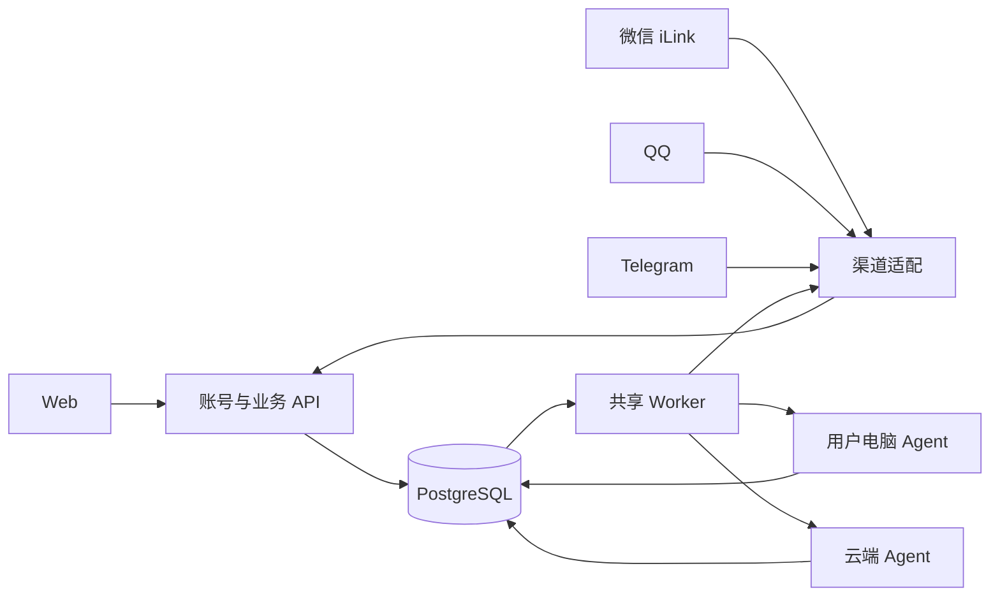

# 当前架构

Cloud Puffer 由 Next.js Web、一个共享 Worker 和 PostgreSQL 组成。Web、微信、QQ、Telegram 的文字消息进入同一账号级主对话。服务端先验证会话或渠道绑定，再持久化入站消息、运行和队列任务；Worker 执行云端 Agent 或等待账号选定的本地设备提交结果。回复写回主对话，并按原消息来源投递。

## 模块职责

| 模块 | 主要职责 |
| --- | --- |
| `src/app`、`src/components` | 首页、工作区、账号流程、状态展示和 HTTP 入口 |
| `src/server/http.ts`、`auth.ts` | 会话验证、同源写入、输入边界和邮件 |
| `tasks.ts`、`memories.ts`、`owned-write.ts` | 账号归属、版本、幂等和事务；网页与 Agent 共用 |
| `conversations.ts`、`queue.ts` | 每账号主对话、历史、取消、入队与顺序执行 |
| `agent.ts`、`agent-model.ts`、`agent-prompt.ts`、`preferences.ts` | 模型工具循环、服务端模型接入、助手设定和能力开关 |
| `agent-devices.ts`、`scripts/local-agent.ts` | 设备令牌、运行领取、本机确认及结果提交 |
| `ilink.ts`、`qq.ts`、`telegram.ts`、`channel-delivery.ts` | 绑定、接收、去重、渠道限制和投递状态 |
| `credits.ts`、`admin.ts` | 每日积分、个人上限及管理员操作 |
| `src/worker.ts` | 单实例租约、四个并发用户、渠道轮询和队列消费 |
| `src/db`、`drizzle` | Schema、连接与增量迁移 |

## 不变量

- 身份由服务端会话或已验证渠道绑定确定，不接受客户端指定的账号 ID。业务写入锁定账号和当前运行，版本冲突明确返回；成功操作与记录同事务提交。
- pg-boss 的账号键 FIFO 保证同一用户回合顺序；不同账号可并发。PostgreSQL advisory lock 防止第二个 Worker 同时轮询渠道。扩容前的改造顺序见[扩容待办](worker-scaling-todo.md)。
- 本地设备令牌只存摘要，领取范围限所属账号。设备离线、取消或中断的运行不会被云端模型自动重放。本地连接程序仅处理文字，不获得云端事项和记忆工具。
- 微信、QQ、Telegram 只处理已绑定身份的受支持私聊。渠道 API 接受请求记为 `accepted`，不代表用户已读；网络结果不明记为 `unknown`，不自动重发。重绑创建新连接，旧回复目标不能用于新身份。
- 模型工具受当前账号、运行和助手能力开关约束。长期记忆按需查询，不自动注入整库；清空聊天保留独立事项、记忆和用量记录。个人每日积分依据模型报告的 token 结算，不能充当平台货币成本硬上限。

## 部署边界

GitHub Actions 在 PR 和 push 时运行检查，push 到 `main` 后构建不可变 digest 并部署 staging；生产手动推广 staging 的同一镜像。两个环境各有数据库、认证密钥与 Compose 项目。Caddy 只代理本机 Web 端口，数据库无公网端口。发布和回退步骤见[部署说明](deployment.md)。

界面材质参考 Glasscn 并保留其许可；业务不依赖该组件库。依赖与素材声明见[第三方声明](../THIRD_PARTY_NOTICES.md)。
