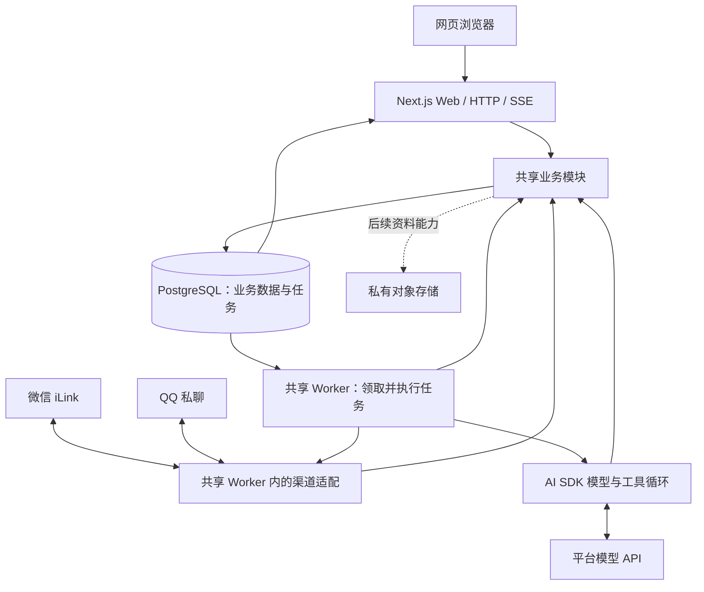

# JOJOBOT 技术与 UI 选型

日期：2026-11-02 · 状态：选型研究记录，核心方案已落地到开发预览；当前落地差异见 [架构](architecture.md)，精确版本见 `package.json` 与锁文件。

用户已确认使用 Apple 风格的 Glassmorphism、优先复用现成组件，并在现有 Linux 云服务器上通过 Docker 部署。本文其余技术选择是基于 [PRD](PRD.md) 的推荐基线，区别于已实现能力；已采用依赖的精确版本以 [package.json](../package.json) 和 [pnpm-lock.yaml](../pnpm-lock.yaml) 为准。

## 当前落地与原方案差异

| 领域 | 当前实现 |
| --- | --- |
| 应用与运行 | Next.js 16 + React 19 + TypeScript；Node.js 24、pnpm 10.30.3；Web/Worker 共用源码和 PostgreSQL 17。 |
| 界面 | 直接使用 Base UI Button/Dialog，Glasscn 的 CSS 材质与项目设计令牌；未引入整套 shadcn CLI、AI Elements 或 assistant-ui runtime。 |
| 聊天与配置 | 自有 `ChatPanel` + react-markdown/remark-gfm；桌面左侧编辑配置、右侧手机主对话，手机端通过导航切换。人设、提示词和开关存入账号偏好。 |
| Agent 与后台 | AI SDK Core 负责工具循环；pg-boss 负责入队与按用户顺序执行，一个共享 Worker 最多并行处理四个用户。 |
| 账号与业务 | Better Auth 邮箱密码；Drizzle 管理迁移；当前支持待办、明确保存的记忆和每日对话额度。 |
| 渠道 | 仓库内 iLink 文本适配、QQ 官方 SDK 私聊适配，均默认关闭；真实账号收发仍待验证。 |
| 验证 | TypeScript、ESLint、Vitest 已配置；浏览器通过人工/自动操作验收，未建立独立 Playwright 测试套件。 |
| 仍为候选 | pgvector、对象存储、PDF.js/Mammoth/docx、联网搜索、提醒调度和管理后台尚未实现，不视为现有依赖或能力。 |

当前架构与接口归属见[架构](architecture.md)，实际验证记录见[开发与验证](development.md#验证记录)。下文的组件比较与推荐表保留初始选型依据，不能直接当作安装清单。

## 1. 原始推荐基线

推荐一套 TypeScript 代码、一个 Web 应用、一个共享后台进程，复用同一个 PostgreSQL。用户拥有独立数据和执行状态；注册用户不会增加独占服务器或常驻 Agent 容器。

| 领域 | 推荐选择 | 当前用途与取舍 |
| --- | --- | --- |
| 语言与运行时 | TypeScript、Node.js 24 LTS、pnpm | 前后端和微信适配共用语言。24 仍在 LTS 支持范围；初始化时固定受支持补丁版。 |
| Web 与 HTTP 接口 | Next.js 16 App Router、React 19 | 登录、主对话、事项、资料、设置与受保护的 `/admin` 放在一个应用中；同源接口调用业务服务。 |
| 样式与基础组件 | Tailwind CSS 4、shadcn/ui 的 Base UI 方案 | 获得可修改的组件源码和交互基础，维护一套 JOJOBOT 设计令牌。 |
| 玻璃材质 | 按需复用 Glasscn 的 CSS 玻璃组件 | 先采用 `frosted` / `subtle` 材质，再统一圆角、色彩、模糊与阴影；折射效果只作可选增强。 |
| 聊天展示 | shadcn/ui 的 AI Elements 按需取用 | 复用消息、输入、附件、来源与工具状态展示；历史、权限、取消和执行状态由 JOJOBOT 服务端维护。 |
| Agent 执行 | Vercel AI SDK Core | 一个服务端模型与工具循环，工具仅调用已授权业务能力；首版不叠加第二套 Agent 框架。 |
| 账号 | Better Auth + 邮箱密码 | 处理会话、邮件验证与密码恢复；微信绑定属于 JOJOBOT 渠道模块。验证和找回邮件仍需配置发信服务。 |
| 业务数据 | PostgreSQL 17 + Drizzle | 保存账号关联、主对话、运行、事项、记忆、文件元数据和额度；迁移 SQL 可审阅。 |
| 个人资料检索 | PostgreSQL + pgvector | 在资料功能阶段加入分块和向量检索，无需单独部署向量数据库；向量化模型另选。 |
| 可靠任务 | pg-boss + Node.js Worker | 执行对话运行、提醒、解析和文档生成；与业务库共用 PostgreSQL，使用独立队列表结构。 |
| 微信渠道 | 仓库内 TypeScript iLink 适配模块 | 共享后台管理扫码、长轮询、游标、身份映射和投递；参考已调研实现，不 fork 整个平台。 |
| 文件 | S3 兼容对象存储 | 原件与生成文档私有保存；下载前鉴权。服务商与区域待选。 |
| 文档处理 | PDF.js、Mammoth、docx | 分别处理文本 PDF、提取 DOCX 文本、生成 DOCX；TXT/Markdown 直接处理，扫描件 OCR 后续再做。 |
| 部署 | Docker Compose，复用现有 HTTPS 入口 | 独立应用配置、数据与存储权限；不复用其他产品的业务表或凭据。 |
| 检查 | TypeScript、ESLint、Vitest、Playwright | 检查类型与规范；重点验证用户隔离、重复写入、提醒恢复及真实浏览器交互。 |

版本说明：Node 24、Next 16、React 19、Tailwind 4、PostgreSQL 17 是建议的兼容基线，不宣称均为最新大版本。库和镜像的精确版本应在初始化时核对并写入锁文件；当前已有锁文件、集成检查与生产构建，具体证据见 [开发与验证](development.md)；下述表格保留最初候选方案，不代表所有库均已安装。

依据：[Node 生命周期](https://nodejs.org/en/about/previous-releases)、[Next.js 部署](https://nextjs.org/docs/app/getting-started/deploying)、[shadcn/ui](https://ui.shadcn.com/docs)、[AI Elements](https://ui.shadcn.com/docs/ai-elements)、[Base UI](https://base-ui.com/react/overview/about)、[AI SDK Agent](https://ai-sdk.dev/docs/agents/overview)、[Better Auth 邮箱密码](https://better-auth.com/docs/authentication/email-password)、[Drizzle](https://orm.drizzle.team/docs/overview)、[PostgreSQL 支持周期](https://www.postgresql.org/support/versioning/)、[pgvector](https://github.com/pgvector/pgvector)、[pg-boss](https://github.com/timgit/pg-boss)。

文档处理依据：[PDF.js 的浏览器与 Node 示例](https://mozilla.github.io/pdf.js/examples/)、[Mammoth](https://github.com/mwilliamson/mammoth.js)、[docx](https://docx.js.org/)。这些是库级选择，复杂中文排版、表格提取和导出效果仍需用实际样本验证。

## 2. 为什么采用这个边界

| 决策 | 推荐方案 | 比较过的另一种方案 | 本次判断 |
| --- | --- | --- | --- |
| Web/API | Next.js 模块化单体 | Vite + 独立 Hono/NestJS API | 多个渠道可以复用同一业务层。独立 API 会增加部署和认证边界，暂没有相应收益。 |
| Agent | AI SDK 的单一受控工具循环 | 引入完整 Agent 编排框架 | 已确认需求是预设工具和个人数据，当前不需要工作流编辑器、多角色编排或另一套记忆持久化。 |
| 后台任务 | PostgreSQL 队列 | Redis + BullMQ | 提醒与文件处理确需可靠后台；已有关系库可以承载首版队列，先减少一套运维依赖。 |
| UI | shadcn 基础 + 少量玻璃源码 | 全量采用一套新兴 Liquid Glass 框架 | 可以复用现成视觉，同时将主题和业务布局留在项目内，降低小型上游项目变更的影响。 |
| 资料检索 | 业务库内 pgvector | 独立向量服务 | 首版单用户资料规模有限；先在已拥有的数据库内完成带归属过滤的检索。 |

本次不引入微服务平台、Kubernetes、常驻用户沙箱、独立管理后台应用或完整插件市场。后续是否拆分应由实际容量、故障隔离或独立部署需求决定。

## 3. 运行结构与多渠道衔接

图中的业务模块、Agent、渠道模块是代码边界，不代表额外服务。首版部署主要是 `web`、`worker` 和数据库；如已有合适的数据库服务，可给 JOJOBOT 独立库与账号，不必额外创建数据库容器。

- **一份代码，两类进程。** Web 处理页面、认证和 API；后台进程负责微信长轮询与任务调度。模型调用异步等待；有成本和 CPU 消耗的任务设置并发限制，文件解析不得阻塞所有微信连接。先保留在一个仓库与一个应用包中，后台入口共享业务代码，不因目录形式拆成多个包。
- **多个入口，一条主对话。** 网页请求、微信和 QQ 消息转换成同一种输入记录，持久化后创建运行。按用户/主对话串行执行，其他用户可并行；重启后的重复事件依靠持久唯一键去重，不依靠单进程内存锁。
- **运行与网页连接解耦。** 用户关闭网页不自动丢弃已接收的工作。Web 使用 SSE 展示增量及状态，重新连接从持久记录恢复已保存结果；首版不承诺逐 token 重放。跨进程通知以数据库记录为准，可先短轮询，再按实测延迟使用 PostgreSQL 通知；不因此新增 Redis。
- **渠道仅负责输入输出。** 微信回复发回对应来源；网页读取同一历史。凭据和游标持久保存，解绑使旧连接任务失效。后台多副本扩容前必须实现连接归属租约，避免重复轮询；首版可先运行一个共享后台实例。
- **工具使用同一业务规则。** 网页按钮和 Agent 工具均调用事项、资料等业务服务。身份来自已验证会话或渠道绑定，不接受模型/浏览器提供的 owner 作为权限依据。
- **队列重试不等于副作用恰好一次。** 创建事项、产生提醒记录和文档引用使用持久幂等键；微信请求超时保留“结果未知”，不盲目重发。业务记录与任务入队应通过同一数据库事务提交。
- **提醒依赖时间与状态。** 固定提醒不经过模型。先保存提醒记录再投递；更新/取消计划后，旧任务须检查计划版本并停止。恢复时按 PRD 处理错过的提醒。
- **私有资料可追溯。** 分块保留文件、页码/段落和版本引用；先按用户授权范围检索。小规模先使用精确向量查询，是否增加近似索引取决于实测。文件解析失败或向量化失败不宣称已可检索。

## 4. 已有玻璃组件的比较

本次读取了下列仓库的 README、许可证及部分源码，并查看了 Glasscn 和 AndreyBegma Glass UI 的在线演示。关注度和提交时间仅作为维护信号，不能替代质量验收。

| 候选 | 能复用什么 | 已发现的限制 | 结论 |
| --- | --- | --- | --- |
| [Glasscn / kostyniuk](https://github.com/kostyniuk/glasscn-components) · [演示](https://glasscn.vercel.app/) | shadcn registry 源码；按钮、输入、日历、侧栏、弹窗等；CSS 与 SVG 材质；MIT | 新项目，npm 包不是其交付核心；部分组件默认使用 SVG 折射。演示站的源码链接与公开仓库不一致，见下文。 | **首选源码参考及按需复用来源**，不原样复制整站或默认效果。 |
| [Glass UI / AndreyBegma](https://github.com/AndreyBegma/glass-ui) · [演示](https://glass.luna-realm.com/) | 完整令牌、玻璃材质、表单、导航及应用布局；React 19 / Tailwind 4；MIT | 生态仍小，界面模式偏工作台，有自己的一套全局主题和依赖。 | **第二候选**；想直接采用完整玻璃设计系统时值得选择，不与首选全量混装。 |
| [liquid-glass-react / rdev](https://github.com/rdev/liquid-glass-react) · [演示](https://liquid-glass.maxrovensky.com/) | 玻璃折射、边缘高光、弹性等 React 效果容器；MIT | 不是完整表单/导航组件库；README 明确 Safari/Firefox 缺少 displacement 效果。默认分支最后提交为 2025-06-13。 | 可用于独立视觉实验，**不作首版 UI 基础**。 |
| [shadcn-glass-ui / artyhoo](https://github.com/artyhoo/shadcn-glass-ui-library) · [演示](https://artyhoo.github.io/shadcn-glass-ui-library/) | 较完整的玻璃组件和主题、Storybook | README/package.json 写 MIT，根 LICENSE 实为 Apache-2.0。 | 暂不选用，需先厘清实际分发版本的许可声明；并非因为 Apache-2.0 本身不可用。 |
| [Glass UI / crenspire](https://github.com/crenspire/glass-ui) · [演示](https://glass-ui.crenspire.com/) | shadcn registry、较丰富组件、WebGL 材质与 CSS 降级 | README 宣称 MIT；本次默认分支根 LICENSE 请求为 404，仓库 API 未识别许可。WebGL 增加实现和验证成本。 | 保留为视觉参考，本次不引入源码。 |

### 原始复用建议

最初建议采用 `shadcn/ui + Base UI + Glasscn 的少量组件源码`，先覆盖侧栏、按钮、输入区、卡片、选择框、日历和弹窗。对话展示从 AI Elements 取必要模式，统一改成 JOJOBOT 的材质与间距，不再并装一套独立聊天运行时。

Glasscn 的 `glass-variants.ts` 已提供 CSS 模糊/半透明方案。但 `GlassButton` 默认是 `liquid-refract`，其 SVG 实现通过浏览器识别规避 Safari/Firefox 的限制。因此不能把“使用此库”写成“所有浏览器均有完整 Liquid Glass”；首版应显式采用 `frosted` 或 `subtle`，关闭不必要的持续背景动画，把材质值提取成项目令牌，并补足减少透明度与不支持模糊时的实色降级。

演示站在本次检查时链接到 `kostyniuk/glasscn`，该仓库 API 返回 404；可审查的公开源码是 `kostyniuk/glasscn-components`。所以演示仅用于判断视觉方向，不能证明它与所读源码完全一致。实际引入以固定提交的公开源码为准，保留版权，不直接执行未经审阅的远程 registry 安装链。

关键源码：[材质](https://github.com/kostyniuk/glasscn-components/blob/15aa50012e6b7e3c84861e66c41f2b911237c685/lib/glass-variants.ts)、[按钮默认值](https://github.com/kostyniuk/glasscn-components/blob/15aa50012e6b7e3c84861e66c41f2b911237c685/components/ui/glasscn/glass-button.tsx)、[SVG 折射实现](https://github.com/kostyniuk/glasscn-components/blob/15aa50012e6b7e3c84861e66c41f2b911237c685/components/ui/glasscn/liquid-glass.tsx)、[MIT](https://github.com/kostyniuk/glasscn-components/blob/15aa50012e6b7e3c84861e66c41f2b911237c685/LICENSE)。

### 维护与许可核验快照

数据来自 2026-11-02 的 GitHub 仓库和默认分支查询；本次未运行这些上游项目的构建或测试。

| 仓库 | Star 快照 | 默认分支提交 / 日期 | 许可文件 |
| --- | --- | --- | --- |
| kostyniuk/glasscn-components | 85 | `15aa500` · 2026-09-17 | [MIT](https://github.com/kostyniuk/glasscn-components/blob/15aa50012e6b7e3c84861e66c41f2b911237c685/LICENSE) |
| AndreyBegma/glass-ui | 5 | `29cb772` · 2026-10-24 | [MIT](https://github.com/AndreyBegma/glass-ui/blob/29cb772953e3f2090f23b6ab95d06a276b591cea/LICENSE) |
| rdev/liquid-glass-react | 6,575 | `ac48eab` · 2025-06-13 | [MIT 文本](https://github.com/rdev/liquid-glass-react/blob/ac48eab18d1f7f444ae30002d240cae29c863a21/LICENSE) |
| artyhoo/shadcn-glass-ui-library | 37 | `32d7625` · 2026-09-14 | [Apache-2.0](https://github.com/artyhoo/shadcn-glass-ui-library/blob/32d762578b6b9997851ed8ee930ab10a418b1bf9/LICENSE)，与 README 声明不一致 |
| crenspire/glass-ui | 97 | `e74f533` · 2026-10-14 | 本次未核实到根许可文件，不据 README 认定已获完整许可 |

## 5. JOJOBOT 的玻璃视觉方向

目标是日常使用的个人助手。参考 Apple 的功能层级：玻璃承载导航和控制，内容保持清晰。Apple 官方也将 Liquid Glass 定位为浮在内容之上的导航与控制层，且官方原生组件面向 SwiftUI/UIKit/AppKit，不能直接安装进 React 网页。依据：[Apple Materials](https://developer.apple.com/design/human-interface-guidelines/materials)、[Liquid Glass 概览](https://developer.apple.com/documentation/technologyoverviews/liquid-glass)。

- **桌面：**轻量侧栏、左侧配置与资料管理、右侧常驻手机主对话；保存人设和工具开关后可直接试聊。
- **手机：**默认单列聊天，底部导航切换助手配置、事项、记忆和连接设置；无需在手机上再套一层设备边框。
- **材质：**侧栏、导航和输入区用柔和磨砂；弹层提高底色不透明度；正文不叠加多层玻璃，不逐条消息增加模糊滤镜。
- **颜色：**以中性底色与克制强调色为主，背景允许静态低饱和渐变；实际颜色、圆角、间距和字号由项目样式令牌维护。
- **排版：**系统字体栈，统一字号和间距；使用开源图标，保持触控区域与焦点可见。
- **降级：**已有减少动效、减少透明度媒体查询及不支持模糊时的实色回退；尚未提供用户手动切换的实色模式，真实设备表现仍需验收。

浏览器依据：[MDN backdrop-filter](https://developer.mozilla.org/en-US/docs/Web/CSS/Reference/Properties/backdrop-filter)、[MDN prefers-reduced-transparency](https://developer.mozilla.org/en-US/docs/Web/CSS/Reference/At-rules/@media/prefers-reduced-transparency)。验收覆盖长对话阅读、明暗背景、中文输入法、滚动、移动键盘、弹层焦点、禁用动效和真实微信内置浏览器；初次选型时仅查看上游演示；后续 JOJOBOT 已完成桌面/手机视口及操作验收，详见[验证记录](development.md#验证记录)。真实 Safari 和微信内置浏览器仍待验收。

## 6. 后续功能与正式部署所需配置

用户已确认当前没有准备复用的模型、对象存储或发信供应商，后续一起选择；本次不替用户开通或购买服务。框架选择不绑定某个商业平台。首版只接入实际选定的供应商，通过小范围服务模块封装调用，不提前开发多供应商管理平台。

| 配置 | 当前状态 | 下一步 |
| --- | --- | --- |
| 主模型与向量模型 | 未选择 | 确认已有 API/预算；验证中文、工具调用、流式响应、结构化参数和资料检索质量。OpenAI 兼容接口不代表这些能力都相同。 |
| 联网搜索 | 未选择 | 选择服务端可访问且能返回来源的搜索 API；网页读取需限制目标地址、大小和超时。 |
| 对象存储 | 已选择 S3 兼容方向，供应商未定 | 确认服务器所在区域、现有存储服务与私有下载方式。 |
| 事务邮件 | 未选择 | 选发信服务并验证邮箱验证/重置链路；不扩展为提醒邮件兜底。 |
| 部署资源与备份 | 已确认现有 Linux + Docker，规格未知 | 实施部署时确认内存、数据库/HTTPS 资源与备份保留周期，不假定可占用其他产品全部资源。 |

最小工程与账号/配置/主对话界面已完成。下一步先选择并验证模型与事务邮件服务、完成微信/QQ 实机接入，再按 PRD 推进提醒、搜索与资料能力。选型依据与本地测试不代替真实供应商、渠道和生产容量验收。
